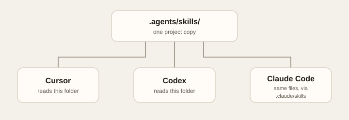
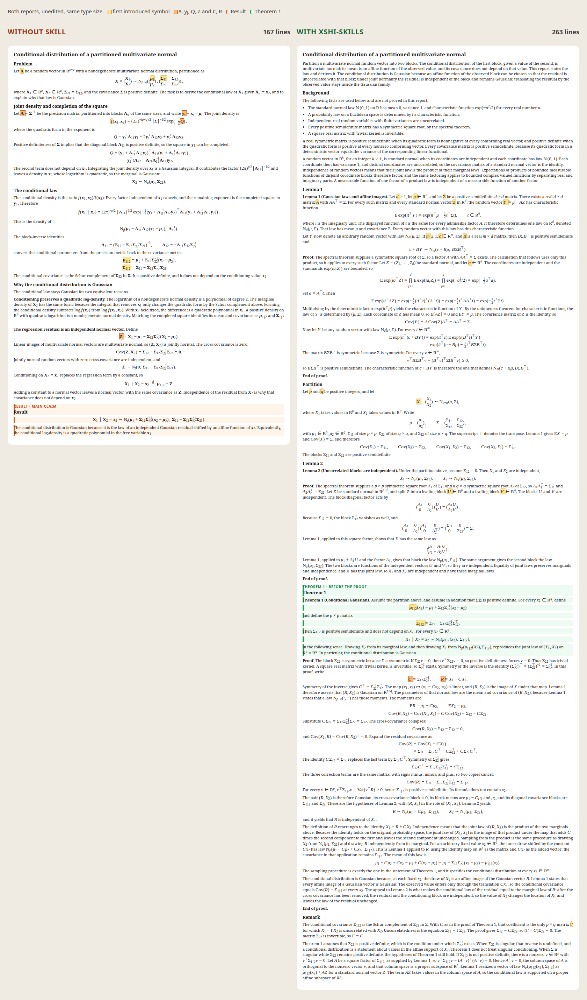
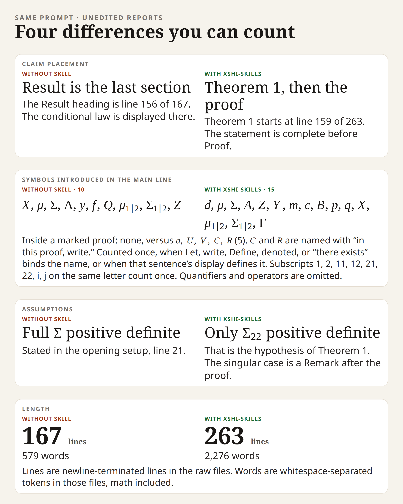

# xshi-skills

English | [中文](#中文)

Agent skills for math writing and scientific computing (math notation, decision records, numerical principles and review, benchmarking, and mutation testing), written by [Xiang Shi](https://github.com/xshi19), who uses them daily for papers and numerical code.

Each skill is a folder with a `SKILL.md` in the open [Agent Skills](https://agentskills.io/specification) format. Cursor is the main target. Codex and Claude Code load the same files.

## Install

In the project, tell the agent:

> Install the skills from https://github.com/xshi19/xshi-skills into `.agents/skills`. Only install the skills I name.

That is the install. Cursor and Codex both read `.agents/skills`. In Cursor, open **Customize** in the sidebar and go to **Skills**. Every installed skill adds its name and description to the agent's context, so name the ones you want.

Call a skill with `/skill-name`, or let the agent choose from the description. The principles and `benchmarking` run only when you name them: `/name` in Cursor and Claude Code, `$name` in Codex.



### install.sh

Optional, from a clone:

```bash
git clone https://github.com/xshi19/xshi-skills.git
cd xshi-skills
./install.sh --project /path/to/your/repo
./install.sh --project /path/to/your/repo math-notation decision-records
./install.sh --list
./install.sh --uninstall --project /path/to/your/repo math-notation
```

`--project` symlinks into that repo's `.agents/skills`, and into `.claude/skills` when `.claude` is already there. Without `--project`, it symlinks into `~/.agents/skills` (created when `~/.cursor` or `~/.codex` exists) and into `~/.claude/skills` when that directory already exists. `--copy` copies instead of linking. `--uninstall` removes symlinks made from this clone and leaves copied directories in place. `./install.sh --help` prints the rest.

### Copy by hand

```bash
mkdir -p .agents/skills
cp -R /path/to/xshi-skills/skills/math-notation .agents/skills/
```

A symlink (`ln -s`) stays current when you `git pull` the clone.

### skills CLI

This layout works with the [skills CLI](https://github.com/vercel-labs/skills) (Node.js 22.20 or later):

```bash
npx skills add xshi19/xshi-skills
```

It finds `skills/<name>/SKILL.md` and copies the skills you pick into `.agents/skills`. Add `--skill math-notation -a cursor` to skip the prompts.

Claude Code reads `.claude/skills` in the project and `~/.claude/skills` for the user. Locations: [Cursor](https://cursor.com/docs/skills), [Codex](https://learn.chatgpt.com/docs/build-skills), [Claude Code](https://code.claude.com/docs/en/skills).

Keep project skills in `.agents/skills`. Cloud Agent sync copies `~/.cursor/skills` only. Automations read `.cursor/skills` in the repository.

## Why

Same prompt, two fresh Cursor sessions: derive the conditional distribution of a partitioned multivariate normal. Without skills, the claim is a closing Result, and the precision matrix $\Lambda$ stays in the derivation. With the skills installed under `.agents/skills`, Theorem 1 is stated before its proof, the coefficient $C$ stays inside the proof, and the singular case is a remark after it. That report is longer (263 lines against 167). Verbatim files: [`examples/math-report`](examples/math-report/).





An earlier polish of one passage is in [`examples/math-notation`](examples/math-notation/).

## Skills

### Math writing

| Skill | What it does | When it triggers |
|---|---|---|
| [`math-notation`](skills/math-notation/SKILL.md) | Audits a final draft for symbols that earn a name, case reductions, and notation after a transformation. Report-only [audit script](skills/math-notation/scripts/notation_audit.py) (Python 3, stdlib). | Finalizing symbols, a without-loss-of-generality step, or a change of variables. Not scratch work. |
| [`statement-before-proof`](skills/statement-before-proof/SKILL.md) | States a numbered or named theorem, proposition, lemma, or corollary before its proof, and puts remarks after. | Drafting or reviewing a proof, a formal derivation, or a cited result proved on the page. |

### Decision records

| Skill | What it does | When it triggers |
|---|---|---|
| [`decision-records`](skills/decision-records/SKILL.md) | Records the choice, the alternatives, who decided, and when to reopen it, or finds the record that already governs the design. [Template](skills/decision-records/references/template.md). | Recording a consequential choice or an inconclusive alternative, or checking prior decisions before a design change. |

### Numerical work

The seven principles and `benchmarking` are invoke-only. `mutation-testing` and `numerical-review` can also be selected from their descriptions. Backend notes (JAX, PyTorch CUDA) live in `references/` and are read only when a skill says so.

| Skill | What it does | When it triggers |
|---|---|---|
| [`principle-code-mirrors-the-math`](skills/principle-code-mirrors-the-math/SKILL.md) | Keeps implemented quantities traceable to the equations, including units and coordinates. | **Invoke** when translating a derivation into code, or exposing more than one coordinate system. |
| [`principle-closed-form-over-general-case`](skills/principle-closed-form-over-general-case/SKILL.md) | Keeps a specialized formula when it meets the contract. Takes on a general solver when its extra failure modes are justified. | **Invoke** when choosing a special-case formula, or folding a direct formula into a solver. |
| [`principle-one-source-of-truth-derive-the-rest`](skills/principle-one-source-of-truth-derive-the-rest/SKILL.md) | Derives related values, derivatives, and inverses from one primitive. | **Invoke** when a value, its derivative, and its inverse could drift apart. |
| [`principle-explicit-backend-no-silent-placement`](skills/principle-explicit-backend-no-silent-placement/SKILL.md) | Makes device placement and fallbacks part of the API. | **Invoke** when changing a backend, device, fallback, or JIT or autodiff support. |
| [`principle-immutable-values-for-math-objects`](skills/principle-immutable-values-for-math-objects/SKILL.md) | Fixes the parameters of a mathematical value, separate from fit state and caches. | **Invoke** when designing a value, a fit result, or a reusable numerical artifact. |
| [`principle-fail-loud-on-invalid-domain`](skills/principle-fail-loud-on-invalid-domain/SKILL.md) | Rejects invalid input and surfaces solver failure. | **Invoke** when handling invalid parameters, failed solves, infinities, clamps, or thresholds. |
| [`principle-choose-the-numerically-honest-formulation`](skills/principle-choose-the-numerically-honest-formulation/SKILL.md) | Chooses a formulation and precision that keep useful digits. | **Invoke** when choosing a representation, formula, dtype, or precision. |
| [`benchmarking`](skills/benchmarking/SKILL.md) | Compares implementations with the contract fixed, both sides tuned, and the spread reported. | **Invoke** when measuring a speedup, regression, or tradeoff. |
| [`mutation-testing`](skills/mutation-testing/SKILL.md) | Mutates one behavior and checks whether tests fail for a real reason. | Tests pass, but a plausible regression, a looser tolerance, or an untested branch might slip through. |
| [`numerical-review`](skills/numerical-review/SKILL.md) | Reviews formulas, derivatives, solver failure, and execution changes against the derivation. | Reviewing a formula, a derivative rule, an iterative solver, or a change to where the code runs. |

`decision-records`, `benchmarking`, and `principle-choose-the-numerically-honest-formulation` can call skills from [pstack](https://cursor.com/marketplace/cursor/pstack) (`why`, `benchmark-checklist`, `principle-explain-the-number`) when that plugin is installed. They are not required.

## Layout

```text
skills/<name>/
  SKILL.md              # name, description, instructions
  agents/openai.yaml    # present on invoke-only skills
  references/           # read only when the skill says to
  scripts/              # optional helpers
```

Invoke-only skills set `disable-model-invocation: true` and `agents/openai.yaml` → `allow_implicit_invocation: false`.

## License

[MIT](LICENSE) © Xiang Shi (xshi19)

[Changelog](CHANGELOG.md) · [Contributing](CONTRIBUTING.md)

---

## 中文

面向数学写作和科学计算的 Agent Skills（数学记号、决策记录、数值原则与审查、基准测试、变异测试）。作者 [Xiang Shi](https://github.com/xshi19) 写论文和数值代码时每天在用。

每个技能是一个带 `SKILL.md` 的目录，遵循开放的 [Agent Skills](https://agentskills.io/specification) 格式。主要给 Cursor 用。Codex 和 Claude Code 加载同一份文件。

### 安装

在项目里告诉 agent：

> 把 https://github.com/xshi19/xshi-skills 里的技能安装到本项目的 `.agents/skills`。只安装我点名的那些。

这就是安装。Cursor 和 Codex 都读 `.agents/skills`。在 Cursor 侧栏打开 **Customize**，进入 **Skills**。每装一个技能，它的名字和描述都会进入上下文，所以只点名要用的。

用 `/技能名` 调用，或让 agent 按描述自己选。七条原则和 `benchmarking` 只有被点名才运行：Cursor 和 Claude Code 用 `/名称`，Codex 用 `$名称`。


#### install.sh

可选。克隆后：

```bash
git clone https://github.com/xshi19/xshi-skills.git
cd xshi-skills
./install.sh --project /path/to/your/repo
./install.sh --list
./install.sh --uninstall --project /path/to/your/repo math-notation
```

`--project` 把符号链接放进该仓库的 `.agents/skills`；若已有 `.claude` 目录，也会放进 `.claude/skills`。不带 `--project` 时，放进 `~/.agents/skills`（本机已有 `~/.cursor` 或 `~/.codex` 时会创建），若 `~/.claude/skills` 已存在也会放一份。`--copy` 改为复制。`--uninstall` 只删除指向这份克隆的符号链接，复制出来的目录会留下。其余见 `./install.sh --help`。

#### 手动复制

```bash
mkdir -p .agents/skills
cp -R /path/to/xshi-skills/skills/math-notation .agents/skills/
```

用 `ln -s` 的话，克隆仓库 `git pull` 之后链接仍然指向最新内容。

#### skills CLI

本仓库的 `skills/<名称>/SKILL.md` 布局可用 [skills CLI](https://github.com/vercel-labs/skills)（需要 Node.js 22.20 或更高版本）：

```bash
npx skills add xshi19/xshi-skills
```

它把选中的技能复制到项目的 `.agents/skills`。加上 `--skill math-notation -a cursor` 可以跳过提问。

Claude Code 读项目里的 `.claude/skills`，以及用户目录 `~/.claude/skills`。

项目里的技能放在 `.agents/skills`。Cloud Agent 同步只复制 `~/.cursor/skills`。自动化任务读仓库里的 `.cursor/skills`。

### 为什么

同一句提示、两次新的 Cursor 会话：推导分块多元正态的条件分布。没有技能时，结论放在最后的 Result，精度矩阵 $\Lambda$ 出现在推导正文里。技能装在 `.agents/skills` 后，定理 1 写在证明之前，系数 $C$ 只留在证明里，奇异情形放在证明后的注记。这份报告更长（263 行对 167 行）。原文见 [`examples/math-report`](examples/math-report/)。


更早的一段润色见 [`examples/math-notation`](examples/math-notation/)。

### 技能

#### 数学写作

| 技能 | 做什么 | 何时触发 |
|---|---|---|
| [`math-notation`](skills/math-notation/SKILL.md) | 审查定稿：符号是否值得单独命名、情形能否不失一般性地归约、变换后是否沿用原符号。附只报告、不改文件的 [审查脚本](skills/math-notation/scripts/notation_audit.py)。 | 定稿论文或证明里的符号、不失一般性、换元之后的记号。不是草稿。 |
| [`statement-before-proof`](skills/statement-before-proof/SKILL.md) | 在证明之前写出编号或命名的定理、命题、引理或推论，评注放在证明之后。 | 起草或审查证明、形式推导，或页面上给出证明的引用结果。 |

#### 决策记录

| 技能 | 做什么 | 何时触发 |
|---|---|---|
| [`decision-records`](skills/decision-records/SKILL.md) | 记下选择、备选方案、谁有权决定、何时可以重开，或找回已经生效的记录。[模板](skills/decision-records/references/template.md)。 | 记录重要决策或尚无结论的方案，或在改设计之前核对已有决策。 |

#### 数值工作

七条原则和 `benchmarking` 需要点名调用。`mutation-testing` 和 `numerical-review` 也可以按描述被选中。JAX、PyTorch CUDA 的说明在 `references/` 里，技能要求读的时候才读。

| 技能 | 做什么 | 何时触发 |
|---|---|---|
| [`principle-code-mirrors-the-math`](skills/principle-code-mirrors-the-math/SKILL.md) | 让实现的量能追溯到方程，包括单位和坐标。 | **点名**。把推导写成代码，或代码同时暴露不止一种坐标系。 |
| [`principle-closed-form-over-general-case`](skills/principle-closed-form-over-general-case/SKILL.md) | 专用公式已经满足合同时保留它；一般求解器多出来的失败方式说得通时才采用。 | **点名**。在专用公式和一般算法之间选择，或把直接公式并进求解器。 |
| [`principle-one-source-of-truth-derive-the-rest`](skills/principle-one-source-of-truth-derive-the-rest/SKILL.md) | 相关的值、导数和逆映射都从一个原始量推导。 | **点名**。一个量及其导数、逆映射可能各写各的。 |
| [`principle-explicit-backend-no-silent-placement`](skills/principle-explicit-backend-no-silent-placement/SKILL.md) | 把设备放置和回退写成 API 的一部分。 | **点名**。改后端、设备、回退，或 JIT、自动微分的支持。 |
| [`principle-immutable-values-for-math-objects`](skills/principle-immutable-values-for-math-objects/SKILL.md) | 数学对象的参数固定，拟合状态和缓存分开存放。 | **点名**。设计一个值、拟合结果，或可复用的数值对象。 |
| [`principle-fail-loud-on-invalid-domain`](skills/principle-fail-loud-on-invalid-domain/SKILL.md) | 拒绝非法输入，并把求解失败显式交出去。 | **点名**。处理非法参数、失败的求解、无穷、截断或阈值。 |
| [`principle-choose-the-numerically-honest-formulation`](skills/principle-choose-the-numerically-honest-formulation/SKILL.md) | 选择能保住有效数字的公式和精度。 | **点名**。选择表示、公式、dtype 或精度。 |
| [`benchmarking`](skills/benchmarking/SKILL.md) | 在契约固定、两边都调过、并报告离散程度的前提下比较实现。 | **点名**。测量加速、性能回退或取舍。 |
| [`mutation-testing`](skills/mutation-testing/SKILL.md) | 改动一处行为，看测试是否因真实差异而失败。 | 测试虽然通过，但一个说得通的回归、放宽的容差或未覆盖的分支可能漏掉。 |
| [`numerical-review`](skills/numerical-review/SKILL.md) | 对照推导审查公式、导数、求解失败和执行方式的变更。 | 审查公式、求导规则、迭代求解器，或代码在哪里执行发生了变化。 |

`decision-records`、`benchmarking` 和 `principle-choose-the-numerically-honest-formulation` 在安装了 [pstack](https://cursor.com/marketplace/cursor/pstack) 时会用到其中的 `why`、`benchmark-checklist`、`principle-explain-the-number`。不装也可以。

### 目录

```text
skills/<名称>/
  SKILL.md              # name、description、说明
  agents/openai.yaml    # 仅点名调用的技能才有
  references/           # 技能要求时才读
  scripts/              # 可选的辅助脚本
```

只点名调用的技能设置 `disable-model-invocation: true`，并在 `agents/openai.yaml` 里写 `allow_implicit_invocation: false`。

### 许可

[MIT](LICENSE) © Xiang Shi (xshi19)

[变更记录](CHANGELOG.md) · [贡献说明](CONTRIBUTING.md)
